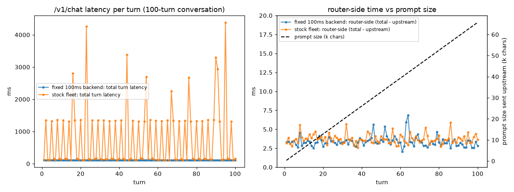

# /v1/generate latency findings

Controlled experiments on `main`, changing one variable at a time and re-running the stock k6 bench (`bench/k6.js`: 30 req/s for 60 s, 1,800 requests). Helper scripts and the plot are in `bench/experiments/`. Production code under `app/` was not changed; any instrumentation was done by wrapping functions at runtime (`bench/experiments/instrumented.py`).

## Ranking by contribution to p99

| # | Cause | Effect on stock p99 (4.06–4.22 s across runs) | Verdict |
|---|-------|-------------------------------|---------|
| 1 | Random slow tail on every backend (~10% of calls take +2.0–3.2 s) | Turning it off: p99 4,123 → **1,363 ms (−2.76 s)** | **Confirmed, dominant** |
| 2 | Round-robin sends 1/3 of traffic to the degraded replica 3 (+1.2 s), with no health or latency check | Turning the penalty off: p99 4,123 → **3,205 ms (−0.92 s)**; raising it to +2 s: **5,064 ms (+0.94 s)** | **Confirmed** |
| 3 | `httpx.AsyncClient(timeout=None)` | 0 ms in the healthy bench (0% errors). When one backend stalls: requests hang until the client gives up, and the whole router stops after ~100 stuck connections | **Confirmed** (an availability risk, not part of today's p99) |
| 4 | Synchronous sqlite3 calls in `/v1/chat` blocking the event loop | 0 ms in the bench (k6 only calls `/v1/generate`; router overhead p99 ≤ 2.8 ms). With very large chats running alongside: +31 ms (2,000-message chats) to +210 ms (20,000-message chats) on generate p99 | **Confirmed mechanism, negligible at bench load** |
| 5 | History growth (`flatten_history` re-sending the full history each turn) | 0 ms measurable: router-side time is flat at 3–4 ms across 100 turns | **Ruled out** in this setup (see caveat) |
| 6 | Audit hook from `scripts/make_degradation_pr.sh` | Not present on `main` | **Ruled out** |

With both backend causes (1 and 2) turned off, the same bench gives **p99 164 ms**: those two explain essentially all of the stock p99. Everything the router itself does is under 3 ms at p99.

## 1. Baseline and router vs upstream split

**Method.** `make services`, `make dev`, `make bench` (with `K6_SUMMARY_EXPORT` to get exact percentiles). For the split, the router was started through `bench/experiments/instrumented.py`, which wraps `RequestLogMiddleware.dispatch` and `UpstreamPool.forward` so each request logs both the middleware `duration_ms` and the upstream call time (with the replica URL) under the same `request_id`. The backend containers' `docker compose logs` only contain access lines without timings, so they were used to check request counts per replica; the upstream time was measured from the router side of the call. `bench/experiments/split.py` computes the split.

**Results (ms, 0% errors in every run):**

| Run | p50 | p95 | p99 | max |
|-----|-----|-----|-----|-----|
| plain `make dev` | 156.4 | 3,023.3 | 4,223.6 | 4,547.3 |
| instrumented, run 1 | 155.6 | 3,026.2 | 4,064.2 | 4,553.9 |
| instrumented, run 2 | 155.0 | 2,983.5 | 4,068.3 | 4,514.4 |

Split for run 1 (1,800 requests):

| | p50 | p95 | p99 | max |
|---|-----|-----|-----|-----|
| router overhead (`duration_ms` − upstream time) | 0.4 | 1.0 | 2.5 | 39.1 |
| upstream time, all | — | — | 4,063.2 | — |
| upstream time, replica 9001 | — | — | 3,173 | — |
| upstream time, replica 9002 | — | — | 3,241 | — |
| upstream time, replica 9003 | 1,336 | — | 4,381.7 | — |

- Traffic share was 33.3% per replica (backend logs: 601 / 600 / 600 POSTs).
- All 18 of the slowest 1% of requests went to replica 9003.
- About 9.4% of requests took over 2 s, which matches the backends' random slow tail.

**Verdict.** The p99 is almost entirely upstream time (99.9%+). The router adds about 2.5 ms at p99.

## 2. Backend stall with `timeout=None`

**Method.** I checked that `UpstreamPool` builds `httpx.AsyncClient(timeout=None)`; at runtime, `client.timeout` is `Timeout(timeout=None)`. I then ran three tests:

- (a) Point the router at `bench/experiments/blackhole.py`, a TCP listener that accepts and reads but never answers, and send one request.
- (b) `docker pause llm-service-2` during the stock k6 bench.
- (c) `bench/experiments/pool_exhaustion.py`: upstreams set to `[blackhole, 9001]`, sending 240 requests 20 ms apart.

**Results.**

- (a) The request was still waiting when curl hit its own 600 s limit (`status=000`, 600.0 s). The router never logged the request, so it would have kept waiting.
- (b) Only 449 of 1,800 requests completed and 1,351 iterations were dropped. The error rate was 55.7% and p50 was 60,000 ms (k6's own 60 s limit). All 250 virtual users got stuck. The router completed 199 requests in the first ~19 s and then **none at all** until the container was unpaused, even for requests meant for the healthy replicas. 100 connections to 9002 were still open after k6 ended, and still open 30 s later. Requests that did complete on 9001 showed upstream p99 of 7,305 ms (max 8,675 ms), which is time spent waiting for a free connection.
- (c) Of 120 requests aimed at the healthy backend, 21 hung. The first one hung right after 99 black-hole requests were in flight. httpx 0.28.1's default connection limit is `max_connections=100`.

**Verdict.** Confirmed: requests hang forever. Worse, the stuck requests use up the shared pool of 100 connections, so a single stalled backend stops traffic to *all* backends. This does not show in the healthy baseline, which is why it ranks below causes 1 and 2 for today's p99.

## 3. Round-robin with no health check (delayed backend)

**Method.** `bench/experiments/docker-compose.exp.yml` overrides the backends' latency settings, and `bench/experiments/run_condition.sh` recreates the fleet and runs the stock k6 bench. Only one setting changed per run.

| Condition | p50 | p95 | p99 | max |
|-----------|-----|-----|-----|-----|
| stock (replica 3 +1.2 s, 10% random tail) | 155.3 | 2,962.6 | 4,122.9 | 4,503.7 |
| replica 3 penalty off | 137.8 | 2,779.4 | 3,204.7 | 3,338.7 |
| replica 3 penalty **+2.0 s** | 154.5 | 3,080.4 | 5,063.8 | 5,292.6 |
| random tail off (penalty on) | 149.1 | 1,353.6 | 1,363.1 | 1,369.8 |
| both off | 133.0 | 161.3 | 164.1 | 178.8 |

- With the +2 s delay, replica 9003 had p50 2,138.7 ms and p99 5,243.6 ms, and all of the slowest 1% of requests went to it. With the penalty off, the slowest 1% were spread 6 / 7 / 5 across the three replicas.
- Router overhead p99 stayed between 1.4 and 2.8 ms in every condition.

**Verdict.** Confirmed. Round-robin keeps sending exactly 1/3 of requests to the slow replica, whatever its latency. The damage follows from that share:

- The slow replica handles 33% of traffic, which is above the 5% and 1% cut-offs for p95 and p99. So those percentiles land on its slow responses (and on its slow-tail responses, about 3.3% of all traffic), and they move by about the delay added: +0.94 s at p99 for the extra +0.8 s penalty, −0.92 s when the 1.2 s penalty is removed.
- p50 barely moves (154.5 vs 155.3 ms) because 33% is below the 50% cut-off.
- With the random tail off, p95 and p99 both sit at ≈ 1.36 s, which is replica 3's penalty: 33% of traffic is more than enough to set both percentiles.

## 4. Event-loop blocking by synchronous sqlite3

**Method.** `bench/experiments/run_loop_block.sh` and `loadgen.py`. A fixed 100 ms backend (no random tail) runs on :9010. Open-loop `/v1/generate` traffic runs at 30 req/s for 30 s while `/v1/chat` requests run against pre-seeded conversations (`seed_history.py`), so `get_conversation`, `list_messages` and `add_message` execute on the event loop. I ran the same test with the current code (sync) and with `chat_to_thread.patch`, which wraps those Store calls in `asyncio.to_thread`. Latencies are measured at the client.

| generate latency (ms) | sync p50 | sync p95 | sync p99 | sync max | to_thread p99 | to_thread max |
|---|---|---|---|---|---|---|
| generate only | 105.0 | 110.3 | 114.9 | 129.4 | 107.4 | 123.9 |
| + chat 10/s, 200-message chats | — | — | 116.4 | 132.9 | 123.9 | 146.1 |
| + chat 10/s, 2,000-message chats | 109.9 | 135.7 | 146.2 | 182.4 | 122.6 | 144.6 |
| + chat 2/s, 20,000-message chats (8.2 M-char prompt) | 166.4 | 252.6 | 325.1 | 384.1 | 473.3 | 594.2 |

Cost of each call, measured in-process:

- 20,000-message chat: `list_messages` 96.5 ms, `flatten_history` 15.0 ms, `add_message` 1.5 ms.
- 200-message chat: 0.32 ms, 0.04 ms and 0.46 ms.

**Verdict.**

- The mechanism is confirmed: synchronous Store calls hold up concurrent `/v1/generate` requests in proportion to how long they run. Generate p99 rises +31 ms with 2,000-message chats and +210 ms with 20,000-message chats.
- `asyncio.to_thread` removes most of the 2,000-message effect (146 → 123 ms). At 20,000 messages it is *worse*, because the cost that stays on the event loop is building and JSON-encoding the 8 MB prompt (plus the GIL), not sqlite.
- For the stock bench (generate only, normal chat sizes) this adds about 0 ms to p99. Run-to-run noise at small sizes is about ±10 ms, so the 200-message rows show no real difference either way.

## 5. History growth (1 / 10 / 50 / 100 turns)

**Method.** `bench/experiments/history_growth.py` sends conversations of 1, 10, 50 and 100 turns one after another through `/v1/chat`. For each turn it records total latency, the `latency_ms` the endpoint reports for the upstream call, router-side time (total − upstream) and prompt size. I ran it against the fixed 100 ms backend and against the stock fleet. Plot: `bench/experiments/results/history_growth.png`.

**Results.**

- The prompt grows linearly: 325 → 6,248 → 32,691 → 65,758 characters at turns 1 / 10 / 50 / 100.
- Router-side time does not grow:
  - fixed backend: mean 3.05–3.59 ms for every conversation length; linear fit slope −0.0014 ms/turn (correlation −0.06).
  - stock fleet: mean 3.72 ms; first 10 turns 3.64 ms, last 10 turns 3.77 ms; slope −0.0004 ms/turn.
- `flatten_history` itself takes 0.0001 / 0.0015 / 0.0072 / 0.0148 / 0.14 ms at turns 1 / 10 / 50 / 100 / 1,000.
- On the stock fleet, total turn latency has p50 160 ms and max 4,386 ms. The spikes come from the random tail and from every third turn landing on replica 3; they are not related to turn number.

**Verdict.** Ruled out as a p99 driver for 1–100 turns. The router-side work does grow linearly, but at about 0.15 µs per turn it is too small to measure against 3 ms of fixed overhead. It only starts to matter at thousands of messages (see section 4).

**Caveat.** The backend mock's latency does not depend on prompt size, so this setup cannot show the cost a real LLM would pay to process a prompt that grows with every turn. The prompt sent upstream does grow linearly, so with a real model this deserves a re-test.

## 6. Audit-hook check

**Method.** I searched `app/` (including `app/main.py`) for `scrub`, `audit_record`, `write_audit`, `_INTEGRITY_ROUNDS`, `fsync` and `audit`, listed the middleware on `main`, and checked the git history and PRs.

**Results.**

- The search found nothing in `app/`. `app/main.py` registers only `RequestLogMiddleware`.
- The only commit on `main` containing those names is `b52366b`, which adds the generator script itself (`scripts/make_degradation_pr.sh`).
- `main` has no merge commits.
- The audit PR (#1, "audit/request-logging") was **closed without being merged**, and its head commit `723ada7` is not part of `main`.

For context only (not benchmarked end to end): the injected `audit_record` costs a median **80 ms** of synchronous CPU per call on this VM. Run on every request on the event loop at 30 req/s, that would be 2.4 s of event-loop work per second, more than one loop can process, so the request queue would keep growing.

**Verdict.** Ruled out. The audit hook is not active on `main`, and no merged PR introduced it.

## What to fix, by impact on p99

1. Stop sending traffic to slow replicas and cut off slow calls: route by latency or outstanding requests, eject or down-weight unhealthy replicas, and/or send a backup request when one is slow. This addresses causes 1 and 2, which make up about 3.9 s of the ~4.1 s p99.
2. Set explicit `httpx.Timeout` values (connect/read/pool) and fail over when they expire, so that one stalled backend cannot use up the 100-connection pool.
3. (Lower priority) Move Store work off the event loop and limit how much history goes into the prompt; this only matters for very long conversations.
